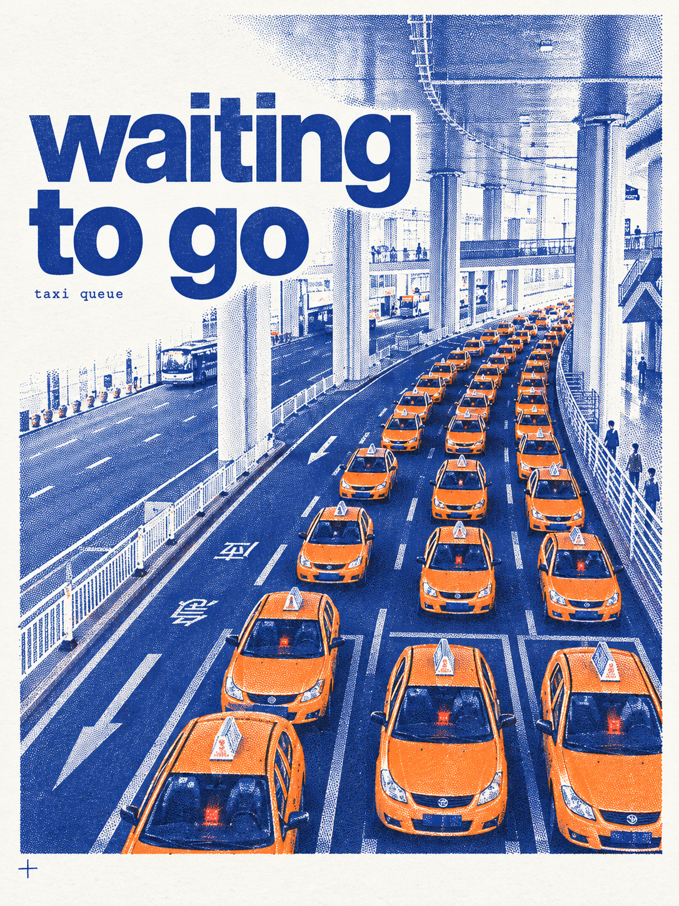
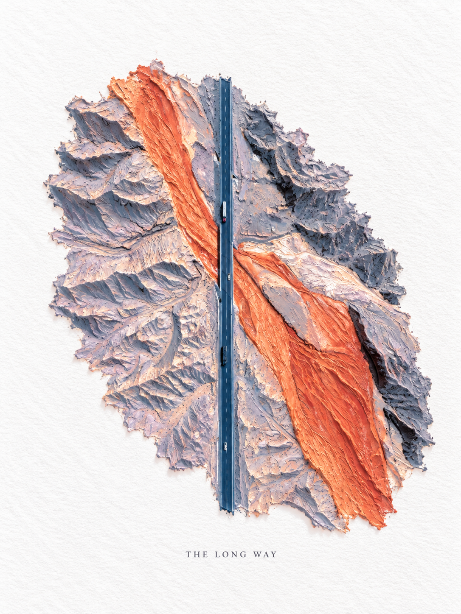
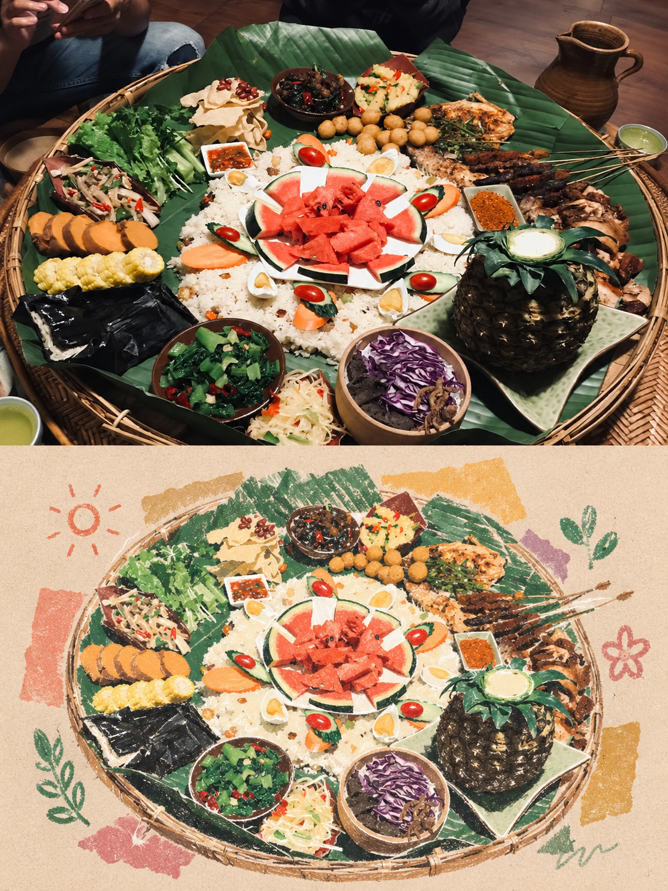
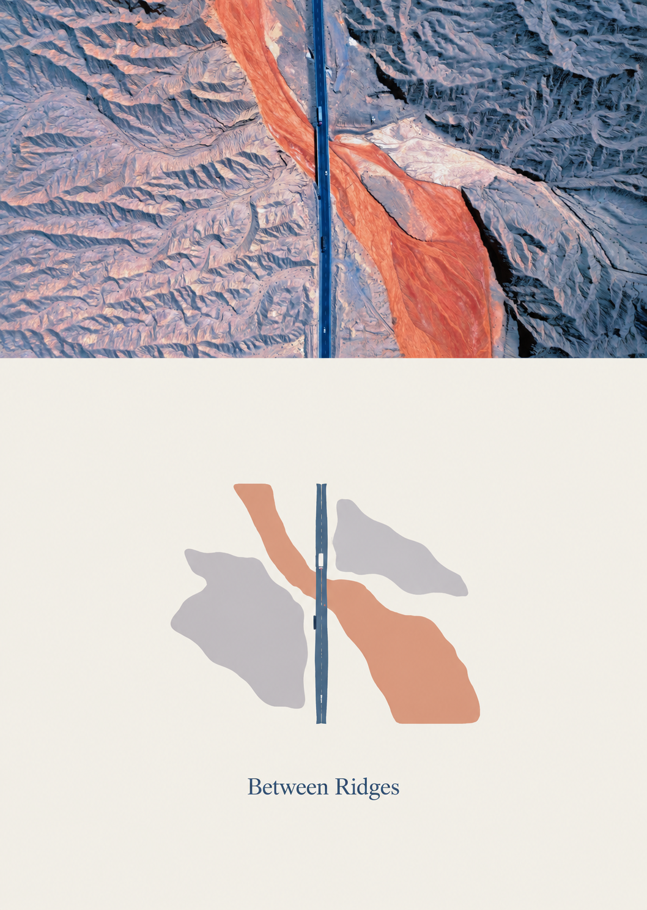
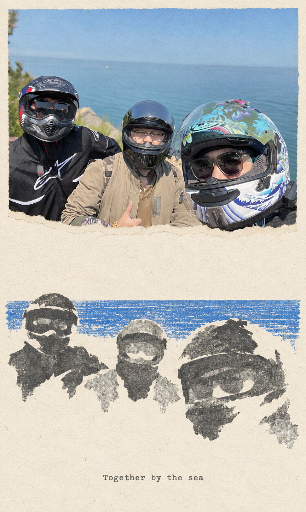
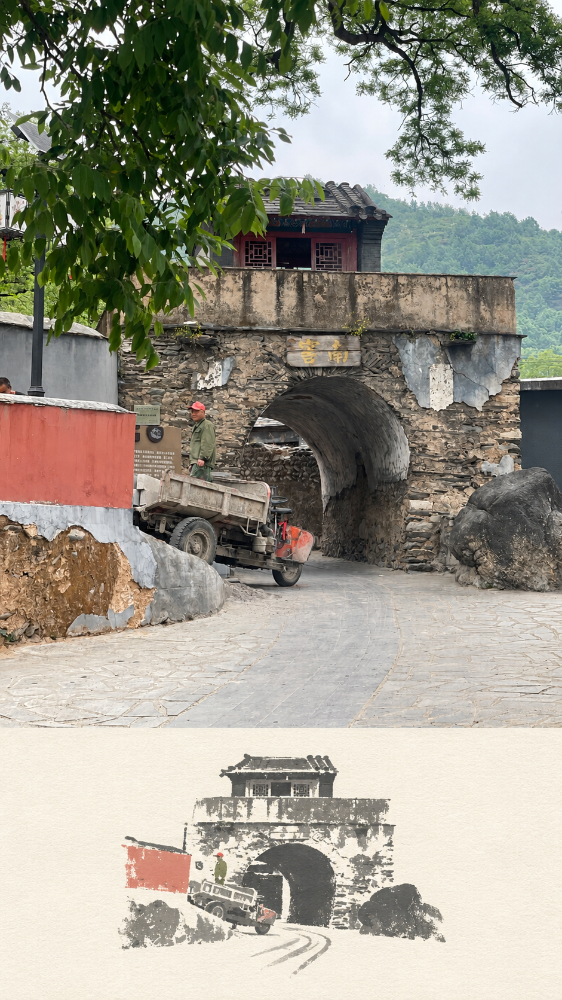
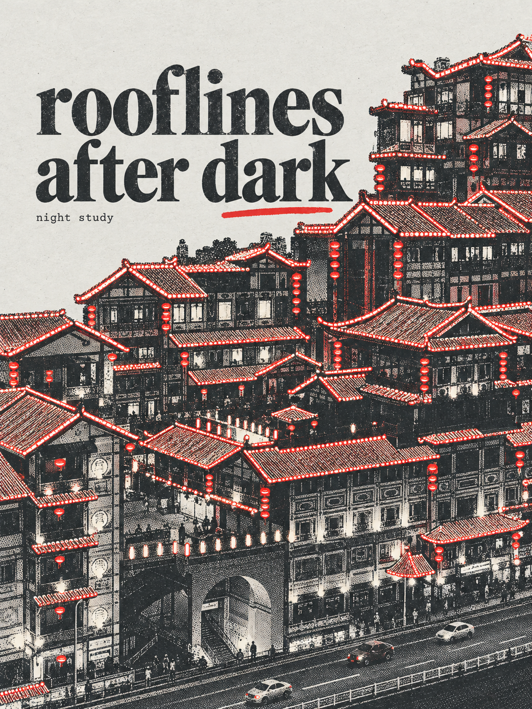
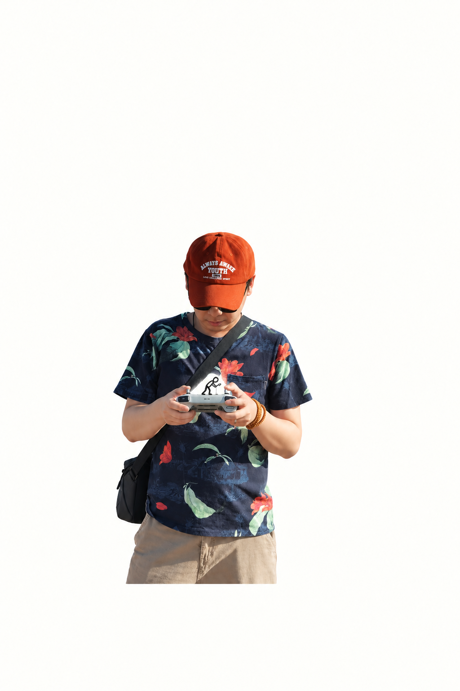
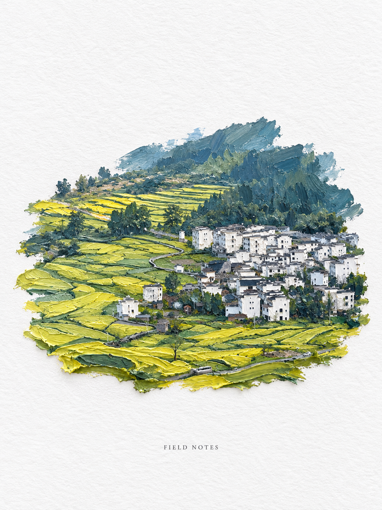
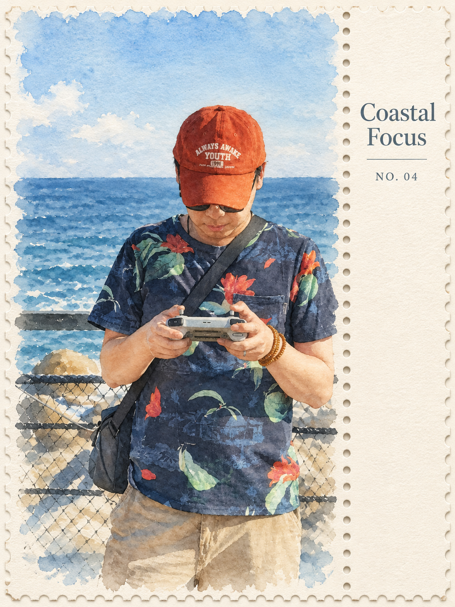

# 变奏 · Photo Variations

把照片交给 Agent，根据主体、构图和用途选一种风格，再用宿主图片工具生成一张作品。

一个入口，八种照片艺术路线：**七款内置，一款按需联网读取**。适合旅行纪念、照片再创作和分享配图；可以自动选款，也可以指定风格。自动选择是基于观察和规则的建议，不保证唯一或最佳结果。

**Photo Variations is an agent skill with eight photo-art routes: seven bundled workflows and one external workflow read on demand from a pinned upstream commit. It uses the host’s image-generation or editing tool; it is not an image engine, and automatic routing does not guarantee the best result.**

## 效果预览

以下十张图来自本项目用户提供的照片，均为实际生成的效果预览，覆盖八种工作流。它们不代表全部严格通过原工作流的质量要求，可能重构局部细节，不能视为原照片的像素保留版本。点击图片查看原尺寸。

原图不公开。示例图按用户授权用于个人非商业效果展示，**不纳入 MIT 授权**；来源、使用条件与已知限制见 [SHOWCASE.md](docs/SHOWCASE.md)。

| 效果预览 | 效果预览 |
| --- | --- |
| **黄色车队 · 双色印刷**<br><a href="docs/showcase/01-taxi-duotone.png"></a><br>工作流来源：<a href="https://github.com/yanliudesign/mono-color-skill">Yan Liu</a> | **航拍公路 · 厚涂油画**<br><a href="docs/showcase/02-aerial-impasto.png"></a><br>工作流来源：<a href="https://github.com/GZ-L/photo-to-poster-skills">GZ-L</a> |
| **美食 · 粉彩拼贴**<br><a href="docs/showcase/03-food-pastel-collage.png"></a><br>工作流来源：<a href="https://github.com/nevertoday/xxd-panel-115">nevertoday（上游发布者）</a> | **公路 · 极简抽象**<br><a href="docs/showcase/04-road-minimal-abstract.png"></a><br>工作流来源：<a href="https://github.com/ZzzLc0405/photo-abstract-editorial/blob/49e55073d6d0330274d31f75d27f5dd6eb35fd6d/LICENSE.md">@AM.</a> |
| **骑行合照 · 拾景拼贴**<br><a href="docs/showcase/05-riders-gathered-collage.png"></a><br>工作流来源：<a href="https://github.com/Zeejay0/gathered-scenes-zine-skill">Zeejay0</a> | **石拱门 · 纸上留影**<br><a href="docs/showcase/06-gate-photo-relic.png"></a><br>工作流来源：<a href="https://github.com/wnby/photo-relic-editorial">wnby</a> |
| **城市夜景 · 单色或双色印刷**<br><a href="docs/showcase/07-night-limited-ink.png"></a><br>工作流来源：<a href="https://github.com/yanliudesign/mono-color-skill">Yan Liu</a> | **海边人像 · 小人涂鸦**<br><a href="docs/showcase/08-portrait-doodle.png"></a><br>工作流来源：<a href="https://github.com/Hchen1218/heytea-style">heytea-style contributors</a> |
| **村落 · 厚涂油画**<br><a href="docs/showcase/09-village-impasto.png"></a><br>工作流来源：<a href="https://github.com/GZ-L/photo-to-poster-skills">GZ-L</a> | **海边人像 · 水彩旅行卡**<br><a href="docs/showcase/10-portrait-watercolor.png"></a><br>工作流来源：<a href="https://github.com/GZ-L/photo-to-poster-skills">GZ-L</a> |

## 安装

仓库：[getinslow/photo-variations](https://github.com/getinslow/photo-variations)

从仓库下载或克隆后，**只安装 `skills/photo-variations/` 目录**；使用发布 ZIP 时，安装其中完整的 `photo-variations/` 目录。不要把整个仓库当作 Skill 安装，也不要只复制 `SKILL.md`，工作流、参考文档和脚本需要一起保留。

Codex 用户技能目录示例：

```text
~/.codex/skills/photo-variations/
```

其他宿主使用各自的 Skill 目录。也可以把仓库地址交给支持安装 Skill 的 Agent：

> 帮我安装 https://github.com/getinslow/photo-variations 中 `skills/photo-variations` 目录的 Skill。

安装后开启新会话检查；若 Codex 尚未发现，可以重启应用。安装目录不需要包含上面的示例图。

## 使用

附上照片，输入：

> 用 $photo-variations 自动选一种适合这张照片的风格，生成一张作品。本次为个人非商业用途，重点保留人物动作与场景。

也可以明确指定：

> 用 $photo-variations 做成水彩旅行卡。本次为个人非商业用途，保留这三个人和头盔。

> 用 $photo-variations 做双色印刷海报，不新增文字。本次为个人非商业用途。

> 用 $photo-variations 分析这张照片，只给风格判断和提示词，先不要出图。本次为个人非商业用途。

告诉 Agent 照片用途和必须保留的内容，会帮助它做选择。明确指定风格时，不会自行换款。默认每张输入生成一张作品，不把八种风格混在一张图里。

**“个人非商业用途”是用户对本次使用的声明，不是安装后的全局默认。** 商业用途请如实说明，并提供受限工作流所需的对应授权。

## 八种风格

中文名与视频中的叫法对应，英文 ID 用于准确指定工作流。

| 视频名称 | 工作流 ID | 主要表达 | 提供方式 |
| --- | --- | --- | --- |
| 水彩旅行卡 | `watercolor-travel-card` | 轻透明水彩、档案边栏与圆孔分隔 | 内置 |
| 厚涂油画 | `impasto-miniature-landscape` | 堆叠油彩与微缩场景质感 | 内置 |
| 纸上留影 | `photo-relic-editorial` | 摄影区域与纸面提炼相呼应 | 内置 |
| 小人涂鸦 | `heytea-doodle-poster` | 真实主体与黑线微型工人互动 | 内置 |
| 单色或双色印刷 | `mono-color` | 有限墨色、网点与纸面露白 | 内置 |
| 拾景拼贴 | `scenes-gathered-zine-v1-3` | 摄影片段、抽象色场与手撕纸边 | 内置 |
| 极简抽象 | `photo-abstract-editorial` | 将照片空间关系提炼为极简构成 | 按需联网读取 |
| 粉彩拼贴 | `xxd-panel-115` | 摄影与粉彩蜡笔、材料拼贴结合 | 内置 |

极简抽象使用[固定上游版本](https://github.com/ZzzLc0405/photo-abstract-editorial/tree/49e55073d6d0330274d31f75d27f5dd6eb35fd6d)。其许可欢迎非商业使用及成果分享，但没有明确授予源码再分发，因此本仓库不复制其原文件，由 Agent 按需联网读取。离线或无法读取时，自动模式绕过这一款；明确点名时报告依赖不足，不静默换款。

## 它怎样工作

Agent 看照片与使用语境 → 检查许可和工具条件 → 选一种工作流 → 读取对应规范 → 调用宿主图片工具 → 查看结果 → 写入不可见署名并验证 → 交付。

每张实际输出在图片元数据中保留 `创作者×变奏` 的工作流来源署名，画面不出现水印，不重编码图片。支持 PNG / JPEG / WebP；需要 Python 3.10+。写入安排在拼版、优化和 XXD 清理之后。作者采用上游原署名或已核实发布者，具体身份及读取命令见 [署名规范](skills/photo-variations/references/attribution.md) 与 [作者登记](skills/photo-variations/references/creator-registry.json)。

转存或平台压缩可能删除元数据，不能把它当作不可去除的版权保护；上游原许可及要求的公开署名继续保留。

路由脚本只对 **Agent 提供的视觉观察** 排序，本身不识别图片，也不调用生图服务。人物与重要风景共同构成旅行记忆时，自动选择会提高水彩旅行卡的适配度；明确风格、用途和保留要求仍然优先。

## 运行条件与边界

- 宿主 Agent 需要能读取 Skill 文件并查看照片。**实际出图需要宿主具备图片生成或编辑工具**；安装这个 Skill 不会新增图片模型或服务。
- Python 路由脚本是可选辅助，没有 Python 时可以按文档选择。没有图片工具时，只能交付提示词，并明确尚未出图。
- 极简抽象需要可用的联网读取能力，及符合上游条件的使用语境或对应授权。
- **粉彩拼贴 / XXD** 另需 Python 3.10+ 和 ExifTool。辅助流程源码已经内置，ExifTool 可执行文件未包含。缺少依赖时，自动模式选择其他可完成路线；明确点名 XXD 时报告缺失条件。
- 生成图可能重构局部细节。交付前应检查人数、动作、手部、文字和空间关系；不能仅凭提示词中的“保留”承诺保真。要求原图像素完全不变时，还需要宿主具备直接放回原图的拼版能力。
- 这些工作流用于艺术再创作。修糊、修曝光、去游客等纯修图需求，应交给宿主相应编辑能力处理。

## 许可与来源

本项目按 **source-available、混合许可** 提供，不是八款统一采用 MIT。上游工作流保留各自版权、许可证和来源：

- 水彩旅行卡、厚涂油画、纸上留影、小人涂鸦、单色或双色印刷：工作流源文件采用 MIT，原有素材限制仍然有效。
- 拾景拼贴：个人非商业许可。
- 极简抽象：个人学习、研究与非商业使用条件，源文件从固定上游版本按需读取。
- 粉彩拼贴 / XXD：PolyForm Noncommercial 1.0.0。

未说明用途，或商业用途但未取得受限路线授权时，自动选择只考虑五项 MIT 工作流。明确个人非商业用途后，另外三项也可参与选择；极简抽象与 XXD 仍须分别满足执行条件。商业授权需要来自对应权利人，不能由路由替代。

**完整合集免费提供给个人学习、研究和非商业使用。不要将整个仓库标为 MIT、宣称“八款免费商用”，或未经相应授权将完整合集用于收费产品。** 拾景的条件还涉及生成输出用于变现内容；三项受限许可并不完全相同，请分别阅读原文。即使某次自动路由只使用 MIT 路线，也不会改变完整合集的分发许可。

项目许可说明见 [LICENSE.md](LICENSE.md)。作者、原仓库、许可证和素材声明见 [THIRD-PARTY-NOTICES.md](skills/photo-variations/THIRD-PARTY-NOTICES.md)。示例图另按 [SHOWCASE.md](docs/SHOWCASE.md) 的条件展示，不代表原作者为本整合项目背书。

## 包自检

在仓库根目录运行：

```bash
python skills/photo-variations/scripts/validate_bundle.py
```

自检核对必要资源、上游文件哈希和路由规则；它不验证图片生成质量。
